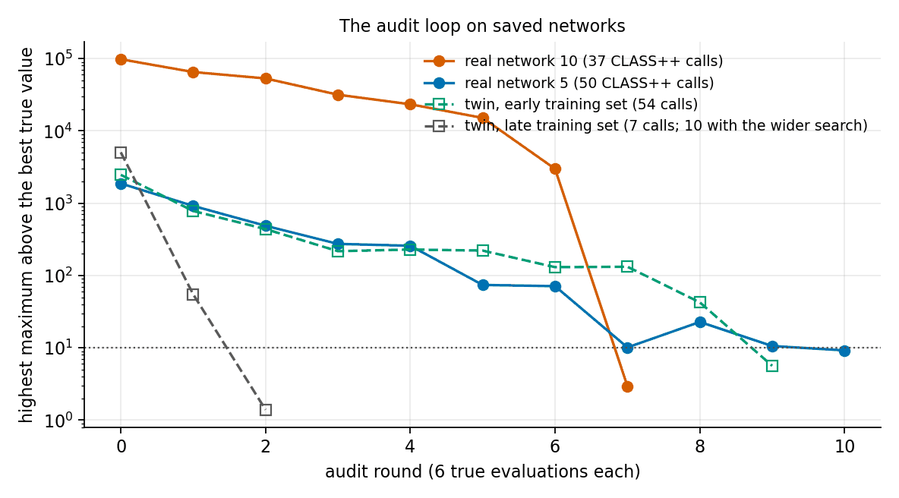
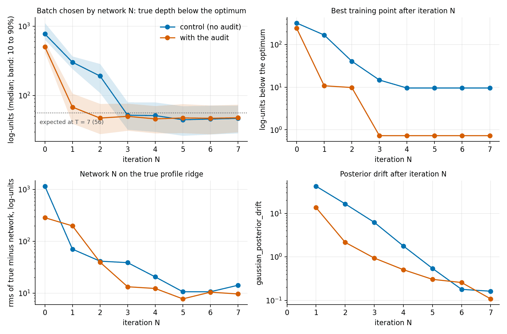
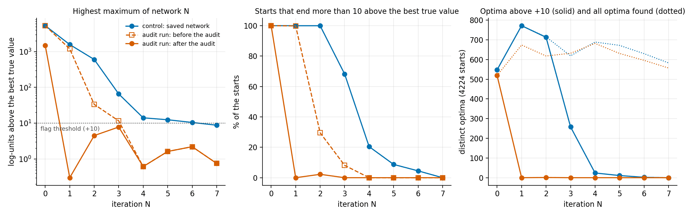
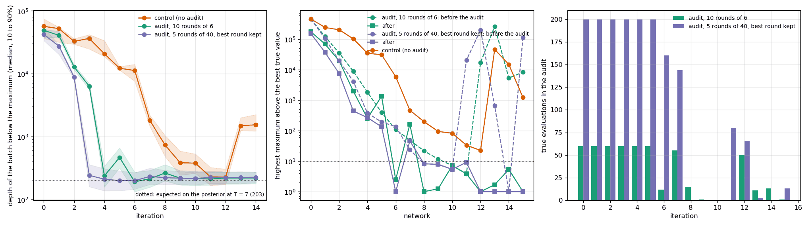
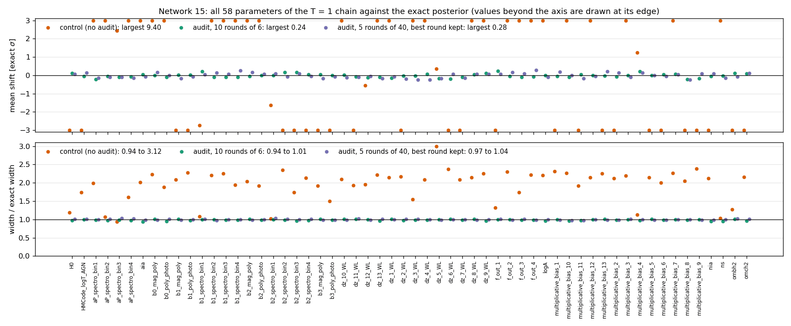
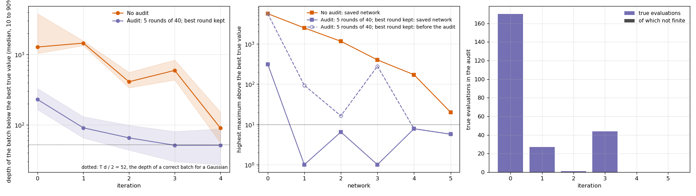
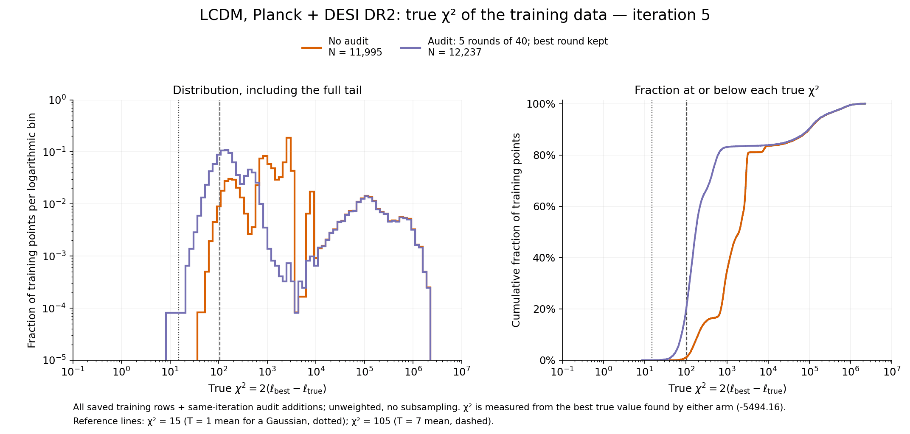

# Auditing the network's optima

`acquisition.audit` checks every newly trained network for maxima it has no evidence for,
with a few true evaluations, before the acquisition chain runs.

```yaml
acquisition:
  audit: {}        # every default; absent or false: no audit
```

## The problem

A network can predict a region far from every training point to be much better than the
best true value seen. Two things make this common:

- The last layer is scaled by the spread of all training targets. For SINU on Planck + DESI
  that is 63 000 log-units, set by the initial design (its points lie up to 1.7 million
  below the best). A normalised output change of 1.7 is then +108 000 log-units.
- The acquisition chain starts its walkers uniformly over the box, so it can find such a
  region.

When the chain finds one, the next batch is drawn there, its true values are all poor, and
that is what corrects the network: a batch of true evaluations and an iteration. When the
chain does not find it, the false optimum stays in the network, and a profile, a global
optimisation or a sampler that covers the box can land on it.

A search of the saved networks of three SINU runs (16 parameters; the search alone, no
true evaluations) found a maximum more than 10 log-units above the best true value in

| run | networks |
|---|---|
| `lr_patience`, `lr_grace`, `patience` × 3 on every iteration | 5 to 10: +1199 to +108 000, 1.1 to 1.4 box widths from the nearest training point, 7 to 15 coordinates at a bound. The chain found that of network 5 and spent a batch on it. |
| ordinary schedule | 0 to 6: +8174 down to +19. Networks 7 onward: none. |

The loss is not the obstacle. msre measures the error relative to each point's depth below
the best, so a true point at a false optimum costs as much as about 400 top points that are
each one log-unit off. The corners are free because no training point is near them.

## What the audit does

After the training of iteration N, on the master:

1. **Search.** Projected gradient ascent on the network from `starts` uniform points, as
   many random box vertices and the 128 best training points. End points within 0.05 box
   widths (per root dimension) are one maximum. A quick search with an eighth of the
   starts runs first; the full search runs when the quick one flags nothing, and in every
   later round of that audit.
2. **Flag** the maxima predicted more than `tau` above the best true value.
3. **Evaluate** the true likelihood at the `k` highest flagged maxima (one collective
   evaluation under MPI).
4. **Fine-tune** on the training set plus all audit points so far, `epochs` epochs at
   `learning_rate`, and search again. Stop when nothing is flagged or after `rounds`
   rounds.

The budget is a fraction of the batch: at most `fraction` × `n_append` true evaluations
per iteration, in `rounds` rounds. With the defaults that is a tenth of the batch in five
rounds, 40 evaluations per round for a batch of 2000.

The audit need not clear a network. While a run is still dominated by false optima it
stops at the round limit in every iteration, and the networks clear over the iterations
(see the 58-parameter run below).

The truth decides. A refuted maximum becomes an ordinary training point where the network
was wrong. A confirmed one is a better point than any seen, which early in a run is common:
the network's optimism then points the right way and overshoots.

The points stay in the training set. They are at most a tenth of a batch, and far fewer
once the networks are clear, so the training density stays what the acquisition made it.

## Keys

| key | default | |
|---|---|---|
| `tau` | 10 | flag threshold, log-units above the best true value |
| `fraction` | 0.1 | true evaluations per iteration, at most this fraction of the batch (`n_append`) |
| `rounds` | 5 | at most this many rounds per iteration |
| `k` | 0 | true evaluations per round; 0: `fraction` × `n_append` / `rounds` |
| `epochs` | 30 | fine-tune per round |
| `learning_rate` | 1e-5 | of the fine-tune |
| `starts` | 0 | uniform starts, and as many vertices; 0: 128 per parameter |
| `steps` | 400 | ascent steps |
| `fit_window` | 100 | the fit check uses points within this of the best true value |
| `start_iteration` | 0 | first iteration audited |
| `chain` | false | in a boost iteration, a round whose climbs flag nothing also looks where the tempered chain's cooled walkers climb to; see "The chain search" |
| `posterior` | 0 | with `chain`: in a boost iteration, this many of the chain's cooled T = 1 walkers evaluated after the search for maxima; see "The posterior pilot". 0: off |
| `posterior_tolerance` | 2.0 | log-units: the network's mean excess over the truth at those walkers above which it is fine-tuned on them |
| `posterior_rounds` | 2 | at most this many pilot rounds |

Results do not depend on the number of MPI ranks: `k` is a setting, not the rank count.

**Why the fine-tunes are not compiled with XLA.** Every XLA compilation leaves memory
mappings that the process never gives back; neither `tf.keras.backend.clear_session()` nor
clearing the kernel cache releases them. A fine-tune compiles a new training step, on a
training set of a new size, so it compiles every time: about 600 mappings per fine-tune of a
5 × 512 network, against about 20 without XLA (measured on a laptop, TensorFlow 2.19). An
audit that stays busy runs up to eight fine-tunes per iteration, and Linux allows a process
65 530 mappings (`vm.max_map_count`). Two runs of 21 iterations on a cluster ended that way,
in iterations 13 and 18, with `LLVM compilation error: Cannot allocate memory` while a fifth
of the node's memory was free; a third, whose audits were clear from network 9 on, finished.
Without XLA a fine-tune takes 10 to 25% longer and its result differs at rounding level.
The fine-tunes are therefore compiled without XLA. The main training and the sampler
compile with XLA, once per iteration each; a continued run is a new process and starts from
zero.

**Why few rounds of many evaluations.** A round costs a search and a fine-tune on the
master, whatever `k` is; its true evaluations run in parallel. On the first network of the
58-parameter Gaussian below, one round lowered the highest maximum by a factor of 1.10
with 6 evaluations, 1.31 with 40, 1.28 with 58 and 1.56 with 200: the evaluations within a round are
partly redundant, so a small `k` uses the fewest true evaluations and a large one the
fewest rounds. The defaults trade the two for runs where true evaluations are parallel.

## What is written, and continued runs

| file | content |
|---|---|
| `RUN/audit/audit_it_N.csv` | the points the audit of network N added: the run's parameters, then `loglkl` |
| `RUN/audit/audit_derived_it_N.csv` | row-aligned inputs and derived values, restored on continuation; missing files or newly requested columns remain NaN |
| `RUN/audit/audit_it_N.json` | the report: per round the highest maximum, the number flagged, how many starts reached each, the predictions and the true values; totals; the fit before and after |

The points are also in `data_it_<N+1>.csv` and every later file. `data_it_N.csv` plus
`audit_it_N.csv` supplies the genuine data used to train `model_it_N.keras`. A run
continued from iteration N with that model loads both, together with the derived sidecar. Its input
rows must match the audit CSV at training precision; mismatches are rejected. An audit
without a sidecar loads with unknown derived values. A network that is retrained is audited again.

The audit runs only when the network is trained in the same process. If a run is
interrupted during an audit, the continuation does not use the saved network as it is: the
training phase was not committed, so its files are set aside (`RUN/interrupted/`) and the
network is trained and audited again (`run/storage.py`, [run_recovery.md](run_recovery.md)).

## Details that matter

- **The audit points are all trained on.** The pipeline holds out a random tenth of the
  training set for the validation loss; a point held out would not correct anything. The
  network's own validation set stays held out during the fine-tune.
- **Each fine-tune keeps its final weights**, not those of the best validation loss: the validation
  points never include the audit points, so that loss is lowest before the correction.
- **The best round's network is kept, not the last one's.** A fine-tune can leave the
  network worse than the one before it. Every round's network is searched anyway, so of
  those searched since the best true value last moved, the one with the lowest highest
  maximum is kept (`kept_round` in the report). The points of every round stay in the
  training set. In the 58-parameter run below, at iteration 5, the highest maximum went
  +395, +750, +6246, +291, +2500, +381, +1181, +1462, +108, +75, +1359 over the rounds;
  that run kept the last.
- **The fit is checked.** Fine-tuning on points the network had badly wrong can leave the
  fit near the best point worse for a while. After the last round, up to three further
  fine-tunes without new points, at a third of the learning rate, run while the rms
  residual of the held-out points within `fit_window` of the best is more than 1.2 times
  its value before the audit. One that does not improve that fit is undone. The report
  has both values. After settling, a full network-only search checks the final weights;
  `final_search` records it and supplies the reported `clear` and `highest_excess`. This
  costs no additional true evaluations. Maxima whose true evaluations failed still count
  against `clear`.
- **A failed evaluation** (not finite) cannot become a training point: the run drops such
  points everywhere. The maximum is set aside for the rest of that audit so the search does
  not return to it, and the report counts it. This is the default `failure_policy: skip`.
  The optional policy below supplies a separate synthetic constraint.

## The chain search

```yaml
acquisition:
  audit:
    chain: true     # off by default
```

The audit looks for maxima by climbing from uniform points, box vertices and the best
training points. A tempered chain reaches places those climbs do not, and in a boost
iteration the chain is what matters: the boost cools its walkers, climbs, and calls every
summit it finds a mode, with the same number of points for each. A false maximum that only
the chain reaches is then corrected by the boost itself, at a third or a half of its points,
and takes all the posterior weight until it is.

With `chain: true`, in a boost iteration (one at or after the boosts' start, when that is
known as the audit runs), a round whose own climbs flag nothing takes one more look:

1. it runs the network's acquisition chain, the one the sampling step would run (same
   sampler, walkers, steps and start), on the master, inside the audit's collective;
2. it cools the last tenth of that chain to T = 1 and climbs, with the boost's own settings
   and seed (`sampling.modes.cooled_peaks`: the first steps of the boost's mode search);
3. a summit more than `tau` above the best true value is evaluated, together with cooled
   walkers that climbed to it, up to the round's `k` points, and the network is fine-tuned
   as after any round.

The summits are taken where they are. The audit's own ascent takes steps of a fixed size and
returns where it ends: handed a summit 16 above the best true value it came back with 9.6,
and it reports 13 to 15 for that summit when it finds it.

Three rules follow from the search being a last look:

- **Its rounds have an allowance of their own**, as large as the climbs' (`rounds` rounds,
  `k` evaluations each). It first sees a maximum when the climbs have nothing left, which
  was often the last round allowed: the maximum was found and left standing.
- **The round that is kept is chosen among like rounds.** The chain search sees maxima the
  climbs do not, so a round it looked at has a higher "highest maximum" than a round it did
  not, whatever the networks are. Compared with those, the deeper look lost and the
  fine-tunes before it were undone.
- **The chain is not run twice.** When the network after the audit is the one the last look
  sampled (nothing was flagged, or nothing changed afterwards), the sampling step takes
  that chain: "Sampling: the chain of the audit's last look is this network's; it is not
  run again". The cooling is then done a second time by the boost.

Why it exists. A 16-parameter run with two modes (SINU on Planck and DESI, 13 October 2026)
was branched to its boosts from a network that had only one of them. The first network
trained after that, from random weights on the quadratic background, had a maximum 67 above
the best true value where the truth was 117 below the network; the audit reported "nothing
above +10", twice. Two boosts put about 1400 of their 4000 points on it and on where it
moved to (a corner of the box, 237 below), and the third network was clean. The same audit
with the chain search, run afterwards on those two saved networks with true values:

| network | chain search finds | rounds, true calls, chains | modes afterwards (peak above the best) | error at boost-like points |
|---|---|---|---|---|
| first after the hand-over | +69, 424 of 512 cooled walkers | 1, 40, 2 | weak (+1.5) and strong (+5.1) | rms 7.9, against 84.8 in the run |
| the same, summit only (no cooled walkers evaluated) | +69 | 2, 7, 3 | weak (+1.5) and strong (+5.5) | rms 7.9 |
| the next (maximum in the corner) | +77, 354 of 512 | 2, 80, 3 | weak (+1.7) and strong (+2.7) | not measured |

The weak mode is left as accurate as it was (0.0 ± 0.2). The strong mode is in the right
place and still over-rated by about 8 after the audit of the first network: correcting that
is the boost's work, now with all its points on the two real modes.

On a small 16-parameter analytic run with the same symptom (a false mode 16 above the best
in the first network after the hand-over) the audit's climbs found the maximum with 1 or 2
of 640 starts and missed it in 3 of 13 seeds; the chain search found it each time it was
needed, with 30 of 512 cooled walkers, and one evaluation removed it. On a boost network of
the 31-parameter ridge the chain search finds nothing (highest summit +2.0) and costs no
true call; over the ten boosts of that run the boost's own summits were +2.0 to +4.2.

Cost: a chain and a cooling for every round that takes the look. In an iteration where
nothing is flagged that is the cooling alone, since the chain is the sampling step's. On the
16-parameter real run a chain is about four minutes on the cluster, and a cooling one to two
minutes on a laptop.

Not established: one real case analysed on its own, after the run on two saved networks;
otherwise it has run only together with other settings, in the branches of
[boost.md](boost.md#two-recommended-settings). The boosts corrected the same maximum by
themselves in two rounds, so what the setting buys is those points and those two networks,
not a run that would otherwise fail. On a 49-parameter network it has run only in that way.

## The posterior pilot

(`posterior`, opt-in, with `chain`.) The search for maxima asks whether the
network has a summit above the best true value. A network can be wrong where its posterior is
without one: too high over a broad region that lies below the best but holds posterior mass
by its volume. The boost is drawn into such a region and spends its points finding it.

In branches of the axion end-to-end run (24 parameters; boost networks trained on a training
domain, `acquisition.boost.train_domain`) the network after the first boost had plateaus some
10 log-units too high: 34% and 22% of its boost points were more than 5 above the truth, at
the edge of the posterior (region distance 1.1 to 1.3 against 0.7, 29 to 40 below the best,
farther from training points than the rest), at low frequency in one branch and in the
foreground amplitudes in the other. The boost errors were 23.5 and 23.0, against 1.0 for the
same network of the control; the audit had cleared those networks. Two boosts later the
network had recovered (1.86).

After the rounds for maxima and the choice of the network kept, the pilot evaluates
`posterior` of the cooled T = 1 walkers of the chain search, the points where the boost's mode
chains start. When the network's mean excess over the truth there is above
`posterior_tolerance`, it is fine-tuned on them (with the audit's other points, as a round's
fine-tune) and the check is repeated on a new chain of the fine-tuned network, at most
`posterior_rounds` times. After a last fine-tune the new network's chain is run once more: its
summits are reported (`highest_excess_after`), nothing is evaluated, and the sampling step
takes that chain. The walkers of the chain search's last look are used when the network is
still the one it looked at (`weights_digest`). The pilot's points are trained on like every
audit point and are in `audit_it_N.csv`; the report has them under `posterior` (each round's
mean excess, rms and share more than 5 above, whether it fine-tuned) and in `true_calls`.

Nonfinite pilot returns count as attempted and failed calls but never enter training.
A batch with no finite returns records `status: no_finite_returns`, null error statistics,
and no fine-tune; posterior accuracy is unassessed, not within tolerance. The pilot uses
its own fixed call allowance and skips nonfinite points; the nearby probes and synthetic
penalties of `failure_policy` apply to the maxima rounds only.

After any pilot fine-tune, or a pilot observation that raises the best true value, a
full surrogate-only climb search and the final model's chain summits determine `clear`
and `highest_excess`. `final_search` records `stage: post_pilot` and the final weights'
digest. The earlier status is retained under `posterior.pre_pilot_status`. This costs
no additional true calls and reuses a chain only if its weights match. A pilot followed
by a no-tune round still reports the final model; clearance is never inherited from the
model before the pilot. These searches remain local diagnostics, not global guarantees.

On those networks the mean excess at the boost points was +11.4 and +9.7 (and +3.5 one
network later), against -1.2 to +1.3 for every network of the control: a tolerance of 2
separates them. A healthy network costs the pilot `posterior` true calls per boost and is not
changed. The pilot draws from the audit's generator only after the rounds, so the rounds and the
network they keep are the same with and without the key, number for number.

Not established: whether a fine-tune on a few hundred points removes a broad plateau that a
boost of 4000 needed two rounds for. Unit tests (`tests/test_audit.py`, `PosteriorPilot`) and
the loop on two ranks (`tests/mpi_audit_chain_smoke.py`, and through the launcher, `hpc/launch.py`,
in `tests/mpi_train_domain_smoke.py`); on real likelihoods it has run only together with other
settings, in the branches of [boost.md](boost.md#two-recommended-settings).

## Numerical failures and synthetic constraints

For CLASS++ domain failures far from the good-fit region, enable:

```yaml
acquisition:
  audit:
    failure_policy: penalize
    failure_probes: 3
    failure_radius: 0.001
    failure_penalty: 1000
    failure_training_fraction: 0.1
```

After a non-finite primary value (NaN or either infinity), the audit tries three distinct
nearby points. Each coordinate moves by at most `failure_radius` times its prior width;
proposals reflect at bounds and remain representable inside the domain. `failure_probes`
may be 1–4 and radius must be in (0, 0.01]. Probes never trigger further probes.
If any probe succeeds, its finite result is ordinary genuine training data and the failed
primary gets no synthetic label. If all probes fail, the primary gets a finite training
constraint at the best genuine objective minus `failure_penalty` (default 1000 log-units).
This is an explicit assumption that the unevaluable region is irrelevant to the fit,
not a measured likelihood or a replacement value returned by CLASS++.

All probes count against the total budget `k * rounds`; they use slots that
would otherwise be available in later rounds. If there is insufficient budget for the
complete probe set, or insufficient distinct representable points, the point is skipped
without a synthetic label. The region is set aside for the rest of that audit. A remaining
high surrogate maximum still prevents `clear: true`; fitting a constraint does not itself
certify success. The penalty magnitude is finite and configurable, not an assertion of
negative infinity, and increasing it does not guarantee faster suppression under MSRE.

Sparse very-low targets can have negligible influence under MSRE. During fine-tuning,
constraints are therefore repeated evenly until their row count reaches at least
`failure_training_fraction` times the genuine training-row count (default 0.1).
Every constraint appears at least once; zero disables repetition. This changes only
fine-tuning weight, adds no true calls, and leaves each stored constraint unique.
The fraction is configurable in [0, 1]. Higher weights may damage the genuine-region fit.

Constraints participate only in audit fine-tuning, alongside genuine training points.
They do not enter genuine CSVs, derived-emulator training, validation, loss-scale
calibration, best-fit estimates, or exact profile outputs. They are saved separately in
`audit/audit_penalties_it_N.csv`, with parameter columns and `penalty_loglkl`. Together
with the real data and applicable earlier penalty files, this records the audit training
inputs for network N. Subsequent newly trained iterations load earlier constraints and
reapply them before the search, only when `failure_policy: penalize` is enabled. A finite
observation at the same float32 coordinates supersedes a constraint. A penalty-only
audit still saves the updated model. Disabling the policy does not undo constraints
already learned by an existing network.

`audit_it_N.json` records probe outcomes, total call budget, failed evaluations, new
constraints and reapplied constraints. `audit_evaluations_it_N.jsonl` journals every true
attempt (including failures), with exception diagnostics when available. Recognised
numerical Python exceptions (`CosmoComputationError`, `FloatingPointError`,
`OverflowError`, `ZeroDivisionError`) enter the same recovery policy. Other Python
exceptions stop the audit after the current MPI batch completes and all workers receive
the termination message; they never justify a poor-likelihood label. Native crashes,
process termination and hung backend calls require separate process supervision and are
outside this exception handling. Other CLiENT evaluation paths do not use this handling.

### Failure-policy validation

`tests/test_audit_failures.py` covers the policy. A manual two-rank smoke test,
`tests/mpi_audit_failure_smoke.py`, runs static and chunked scheduling,
including recoverable exceptions, fatal exceptions and failure while loading constraints.

A four-dimensional trained MLP with an injected false corner maximum was tested with
NaN returned whenever any coordinate exceeds 0.8. Each variant used one failed maximum
plus three failed probes, a penalty 1000 below the best genuine value, and the standard
30-epoch fine-tune at learning rate 1e-5. The initial highest searched excess was 208.95
and held-out RMS within `fit_window` was 1.36 log-units.

| Synthetic rows / genuine rows | Final highest searched excess | Final held-out RMS | Clear |
|---|---:|---:|---|
| no repetition | 208.95 | 1.36 | no |
| 0.1 (chosen default) | 137.73 | 1.40 | no |
| 0.25 | 96.38 | 1.75 | no |
| 1.0 | 1.68 | 2.92 | yes |

Without repetition, the fine-tune increased the false maximum and the existing best-round
rule restored the original network. The conservative default makes progress with little
change in the genuine-region fit, but does not clear this difficult example in one pass.
These are results on one toy network, not CLASS++ or HPC validation. The benchmark behind the
table is not part of the release. The smoke test runs with

```sh
mpiexec -n 2 python tests/mpi_audit_failure_smoke.py
```

## Evidence

On SINU (16 parameters), an analytic twin of it on the same box, a 58-parameter
Gaussian in a ±10σ box, and ΛCDM on Planck and DESI DR2 with the real likelihood. Unless a row
says otherwise the runs used `k: 6, rounds: 10`, not the default budget.

**The loop, on saved networks.** k = 6, 30 epochs at 1e-5.

| network | rounds | true evaluations | highest maximum | |
|---|---|---|---|---|
| twin, early training set (4196 points) | 9 | 54 | +2472 → +5.7 | the chain's true depth below the optimum: 485 → 183 |
| twin, late training set (23 197 points) | 4 | 10 | +5065 → +2.1 | clear under a search with four times the starts |
| real network 10, long-schedule run | 7 | 37 (46 s of CLASS++) | +98 144 → +2.9 | error on the true ridge 1.1 → 0.9 rms |
| real network 5, long-schedule run | 10 | 50 (59 s) | +1879 → +9.2 | clear under the wider search |



Real network 5 is the one whose false optimum the chain found. The pipeline's chain on it,
before the audit: 93.1% of the samples at the false optimum (logGeff −5.00, τ 0.099, calEE
1.059), as in the run. After: 0%, and the chain is in the posterior region (logGeff −3.74,
τ 0.061, calEE 0.998). The audit's 50 evaluations stand against the batch of 2000.

Three true points were enough for a whole region: with the three batch points nearest
network 5's false optimum added (their true values were already known) and 26 seconds of
fine-tuning, the network's prediction at the other 1994 points of that batch went from
+1797 (median, relative to the best) to −1065, where the truth is −1003.

**End to end, on the twin** (16 parameters, ordinary schedule, a pair of runs differing
only in the audit, both stopped after iteration 7).

| | control | with the audit |
|---|---|---|
| batch median depth below the optimum, iterations 0 / 1 / 2 / 3 | 770 / 302 / 191 / 52 | 501 / 68 / 47 / 50 |
| networks with a maximum above +10 | 0 to 6 (+5308 down to +10) | 0 only, after its audit |
| audit true evaluations by iteration | | 60, 60, 6, 16, 0, 0, 0, 0 (55 of the 142 better than the best before) |
| depth of the best point at the end | 9.6 | 0.7 |
| share of the T = 7 chain beyond the barrier at iteration 7 (exact 29.0%) | 26.2% | 23.9% |
| weight of the strong mode at T = 1 at iteration 7 (exact 19.0%) | 10.3% | 2.8% |





The audit corrects optimism, not pessimism. The audited run's first three batches put 0, 2
and 8% of their points beyond the barrier, and its network 7 was 10.1 log-units too
pessimistic at the strong minimum (control 4.2). A hidden mode still needs
`client.py augment`.

**End to end, on the 58-parameter Gaussian** (`input/cobaya/gaussian_cloe58.yaml`, ±10σ
box, T = 7, 2000 + 100 points per iteration, re-injection at every iteration). Three runs
with the same seed, 16 iterations each: no audit; `k: 6, rounds: 10` with the last round's
network kept; the defaults. A batch on the posterior lies 203 log-units below the maximum,
a posterior sample 29.

| | control | 10 rounds of 6 | defaults (5 rounds of 40, best round kept) |
|---|---|---|---|
| first batch on the posterior (its median depth) | iteration 11 (228) | iteration 4 (237) | iteration 3 (241) |
| true evaluations the network that drew it had seen | 25 200 | 10 800 | 9200 |
| batches after that | 225, then 1487 and 1537 at iterations 13 and 14 | 190 to 263; 464 at iteration 5 | 199 to 231 |
| audit true evaluations, of the run's total | | 518 of 34 118 | 1664 of 35 264 |
| audit time per iteration, mean | | 13 min | 6 min |
| best training point at the end, below the maximum | 18.0 | 0.6 | 0.8 |
| T = 1 chain on network 15, depth below the maximum | 3097 | 28.8 | 29.2 |
| Δ^CM at 68% on network 15, median / largest of the 58 parameters | 8.82 / 9.88 | 0.07 / 0.24 | 0.10 / 0.29 |

The chains start as the acquisition chain does (432 walkers uniform over the box, 20 000
steps at T = 7, then T = 1), so that a false optimum in reach is found. Δ^CM compares the
68% interval of each parameter with the exact one, in units of the exact half-width.



Left: depth of each batch below the true maximum (median, band 10 to 90%). Centre: the
highest maximum of each network above the best true value, for the audited runs before
(dashed) and after the audit; values of 1 or less are drawn at 1. Right: true evaluations
made by each audit.

| network | run | T = 7 chain: depth (203) | T = 1 chain: depth (29) | Δ^CM at 68%: largest / median | width / exact width |
|---|---|---|---|---|---|
| 5 | control | 8825 | 28 927 | 9.96 / 6.87 | 0.03 to 0.97 |
| 5 | 10 rounds of 6 | 461 | 377 | 7.15 / 1.55 | 0.25 to 0.57 |
| 5 | defaults | 192 | 62 | 2.09 / 0.87 | 0.31 to 0.83 |
| 10 | control | 379 | 279 | 5.82 / 1.56 | 0.38 to 0.80 |
| 10 | 10 rounds of 6 | 194 | 29.7 | 0.76 / 0.21 | 0.60 to 1.04 |
| 10 | defaults | 193 | 28.7 | 0.70 / 0.17 | 0.73 to 1.02 |
| 15 | control | 1271 | 3097 | 9.88 / 8.82 | 0.94 to 3.12 |
| 15 | 10 rounds of 6 | 194 | 28.8 | 0.24 / 0.07 | 0.94 to 1.01 |
| 15 | defaults | 197 | 29.2 | 0.29 / 0.10 | 0.97 to 1.04 |

All 58 parameters on network 15: shift of the chain's mean in units of the exact σ, and the
chain's width over the exact width.



- **No audit cleared a network before network 6.** The share of the search's starts that
  end in a false maximum was 100, 100, 100, 77, 42, 17, 9, 7, 0, 0, 0% for networks 0 to 10
  with the defaults. The networks clear over the iterations.
- **False optima come back late.** From network 11 on the new networks of both audited runs
  again had maxima of up to +264 147; each audit removed them with 1 to 80 evaluations and
  ended clear. The control's networks 13 to 15 have +46 460, +14 914 and +1226, its
  batches 13 and 14 went there, and the chain on its last network ends there. Why they
  appear at this stage was not investigated.
- **The last round is not always the best.** With 10 rounds of 6 two audits ended on a
  worse network than they began with (network 5: +395 → +1359; network 7: +49 → +163), and
  the batch after the first was at 464. With the best round kept, an earlier round was
  kept in 5 of 16 audits.

**The budget, on the first 58-parameter network** (2100 training points, exact truth,
30 epochs at 1e-5 per round). Highest maximum above the best true value:

| true evaluations | 6 per round | 40 per round | 58 per round | 200 per round |
|---|---|---|---|---|
| 0 | +463 396 | +463 396 | +463 396 | +463 396 |
| 60 (10 rounds of 6) | +175 400 | | | |
| 200 (5 rounds of 40) | | +122 057 | +126 985 at 232 | +261 316 |
| about 1200 | | | +4516 | +44 023 |
| about 2100 | | | +1000 | +3527 |

No budget cleared this network: after 2057 evaluations in rounds of 58, three quarters of
the search starts still ended above +10. The default (5 rounds of 40) lowered the highest
maximum by a factor of 3.8, 10 rounds of 6 by 2.6.

**End to end, on a real likelihood: ΛCDM on Planck and DESI DR2.** Planck low-ℓ TT and
low-ℓ EE, NPIPE CamSpec TTTEEE and DESI DR2 BAO (all tracers) with CLASS++; 15 parameters
(6 cosmological, 9 nuisance). Two arms with the same seed, a control and one with
`audit: {}` (the defaults: 40 per round, 5 rounds, best round kept):
2000 Latin-hypercube points (1995 finite), 2000 per iteration, networks 0 to 5, the ESS
floor, T = 7, and no Gaussian point injection (`prior.n_inject` and
`acquisition.n_inject` 0).

There is no exact posterior here, and the true maximum is not known. Depths are measured
from the best true value found anywhere in the test, −5494.16. A correct batch for a
Gaussian in 15 parameters lies T d / 2 = 52 below the maximum at T = 7, a posterior sample
7.5 below.

| iteration | control: batch median depth (10%, 90%) | audit arm: batch median depth (10%, 90%) | control: highest maximum of the network | audit arm: before → after the audit | audit true evaluations (better than the best before) |
|---|---|---|---|---|---|
| 0 | 1278 (1035, 3801) | 230 (165, 329) | +5612 | +5612 → +312 | 170 (152) |
| 1 | 1452 (1340, 1560) | 91 (65, 131) | +2490 | +94 → +0.4 | 27 (3) |
| 2 | 410 (336, 558) | 66 (44, 99) | +1158 | +16 → +6.5 | 1 (1) |
| 3 | 595 (436, 836) | 51 (30, 81) | +399 | +279 → −10 | 44 (9) |
| 4 | 90 (55, 152) | 52 (27, 88) | +171 | +7.8, nothing flagged | 0 |
| 5 | | | +20 | +5.7, nothing flagged | 0 |



- **Arrival.** The audit arm's second batch is at 91 and its fourth at the expected depth;
  the control's fifth batch is at 90. The posterior drift after iterations 1 to 5 is 5.9,
  2.9, 2.0, 2.2, 0.89 in the audit arm and 59.8, 29.3, 14.9, 11.3, 3.1 in the control.
- **Cost.** 242 audit evaluations in six audits, against about 12 000 true evaluations per
  arm, and 14 minutes of audit time in all. No evaluation failed. Only the first audit ran
  into the round limit; the audits of networks 1 to 3 ended clear and those of networks 4
  and 5 flagged nothing.
- **The early maxima point at the real peak and overshoot it.** The best point of the
  initial design is 1767 below the best value found, and 165 of the 242 audit points were
  better than the best point known at the time. The highest maxima of the control's networks
  0 to 3 lie 3844, 1624, 293 and 165 above the best true value found anywhere in the test.
  Those of its networks 4 and 5 lie 63 and 1 below it, so they need not be false: the peak
  is 235 and 21 above the control's best point at that stage. On this likelihood the audit
  worked as a guided search for the peak as much as a correction.
- **The peak.** The best training point ends 4.4 below the best value found in the audit
  arm and 21.0 below it in the control.

The final networks, checked with the true likelihood at 200 samples of each arm's own
chains on network 5 (256 walkers uniform over the box, 20 000 steps at T = 7, then T = 1):

| | control | audit arm |
|---|---|---|
| T = 1 samples: network minus truth, rms / mean / largest | 2.20 / −0.86 / 7.5 | 1.95 / +0.87 / 12.0 |
| T = 1 samples: true depth, median (7.5 expected) | 7.6 | 6.8 |
| T = 1 samples: importance-sampling effective sample size, of 200 | 6 | 26 |
| T = 7 samples: network minus truth, rms / median absolute | 8.6 / 4.9 | 14.8 / 4.2 |
| T = 7 samples: true depth, median (52 expected) | 40.8 | 46.5 |

Both final networks sample the right region and neither is converged: an error of 2
log-units is too large for an exact posterior. The audit arm's T = 7 rms is set by a few
samples (the largest error is 131).

The two posteriors agree within 0.5σ in ω_b, ω_cdm, H0 and n_s and differ by about 1σ in
τ and ln(10¹⁰ A_s): τ = 0.046 ± 0.006 in the control and 0.056 ± 0.009 in the audit arm.
Reweighting each arm's 200 checked samples with the true values gives 0.049 and 0.054,
which rests on 6 and 26 effective samples.

The training data behind network 5, as for the 58-parameter runs. χ² is 2(ℓ_best − ℓ)
with ℓ_best the best true value found, so it underestimates the true χ² by twice the
unknown gap to the true maximum.

| | control | audit arm |
|---|---|---|
| training points | 11 995 | 12 237 |
| χ² of the training points: 10% / median / 90% | 200 / 1954 / 98 784 | 78 / 173 / 96 070 |
| share with χ² below 105, the T = 7 mean for a Gaussian | 1.3% | 21.3% |
| share with χ² below 210 | 10.8% | 58.5% |



Over the full prior ranges, the control's training set sits in several separate clumps left by
its first four batches; the audit arm's forms one cloud around the posterior.

## Reproducing the runs

```bash
# input/cobaya/gaussian_cloe58.yaml, with acquisition.audit absent (control) and audit: {} (the defaults)
```

The run with 10 rounds of 6 used `audit: {k: 6, rounds: 10}` and kept the last round's network;
the code applies the best-round rule, so that run cannot be repeated exactly. Each run is serial (the likelihood is analytic) and takes several hours
on a laptop.

The ΛCDM arms ran on three MPI ranks each through the launcher (`hpc/launch.py`). They need the Planck
and DESI data and CLASS++, and took 5.6 hours side by side on a laptop.

## What is not established

- **The search is not exhaustive.** On the audited real network 10, a search with four
  times the starts and twice the steps found two more false maxima (+4637, +714) with one
  seed and none with another. The audit removes what its search finds.
- **The number of starts needed in other dimensions is not measured.** 128 per parameter
  reproduces what was used at 16 parameters. `flagged_hits` in the report is there to
  measure it.
- **A removed maximum can be replaced.** On the twin one removal produced two smaller
  maxima elsewhere, gone a round later. Every test so far converged or stopped at the round
  limit with the highest maximum much reduced.
- **Why false optima return late in a run is not understood.** In the 58-parameter runs
  they came back from network 11 on, in the unaudited run too.
- **The default budget has two end-to-end runs,** on the 58-parameter Gaussian and on ΛCDM
  with the real likelihood, both with the best-round rule; the two changes are not
  separated. It has not been run on SINU or the twin.
- **Three problems, one seed each.** SINU with its analytic twin, one Gaussian, and ΛCDM on
  Planck and DESI.
- **On the real likelihood there is no exact posterior to score against.** The two ΛCDM
  arms differ by about 1σ in τ and ln(10¹⁰ A_s) after six iterations, both networks are
  still 2 log-units off on their own posterior, and the control was catching up (its last
  batch at 90, its last drift 3.1). A longer pair would show whether they end in the same
  place.
- **Failed true evaluations did not occur at full size** on ΛCDM (0 of 242), but 5 of 6
  failed in one audit of a 60-point toy run at box corners. The handling of such points
  (above) has no end-to-end test on a real likelihood.
